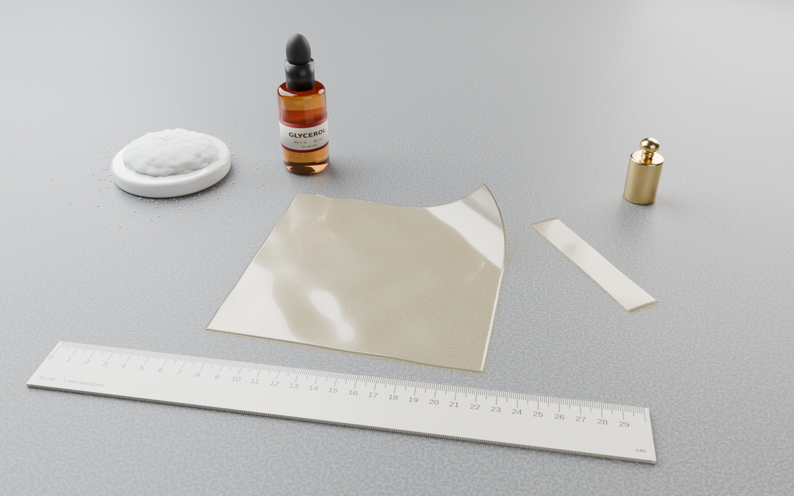

# Open Simulation Bench

*3D model render of the prototype, not a photograph.*

A virtual lab for testing how measurement noise, losses and conditions change the outcome of an experiment. Pick an experiment, run it, and compare what the model predicts with what the simulated instruments read. Every run is seeded, so any result can be repeated.

**Live site:** https://iamgokuld.github.io/open-simulation-bench/

One file (`index.html`), no build step. MIT licensed. All numbers are **simulated**, not results of a physical trial.

## Experiments
- **Starch film casting** (bioplastic from starch): weigh, heat, cast, dry, measure. Seed `116722` is the default run.
- **Cup of tea cooling**: shows the engine works for other experiments.

Add your own by adding an object to the `EXPERIMENTS` block in `index.html`.

## 3D prototype
- `model/prototype.glb`: the starch-film prototype (glTF binary). The site loads the same bytes from `model/prototype.b64.txt`.
- `blender/bioplastic_prototype.blend`: the Blender source.
- `blender/prototype_render.png`: a render of the model (a 3D render, not a photograph).
